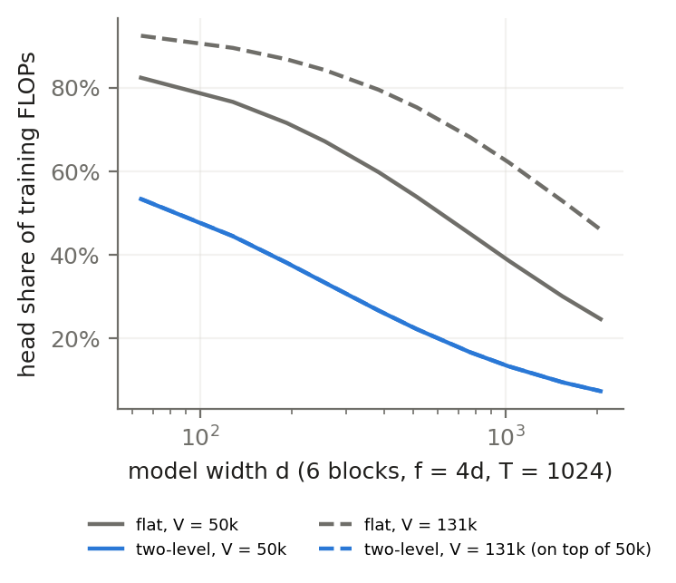
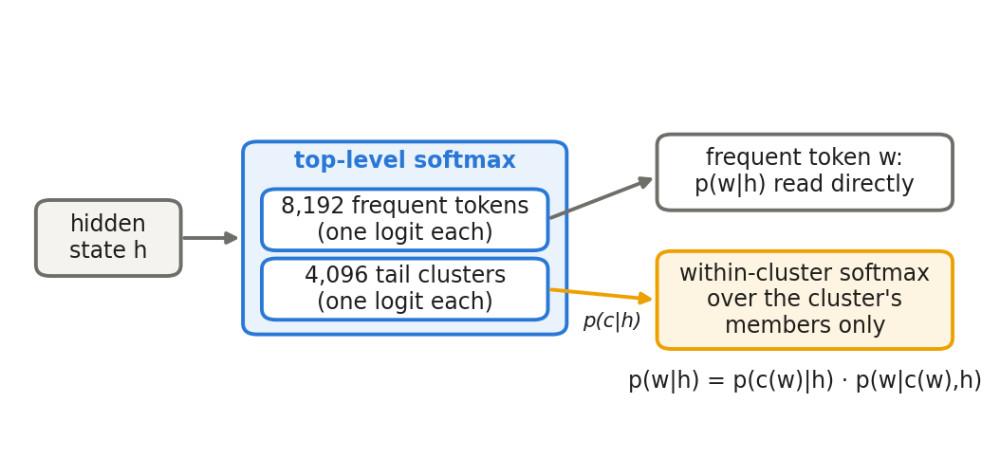
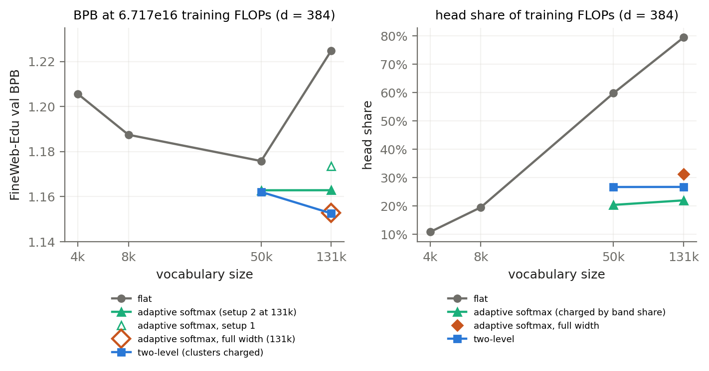
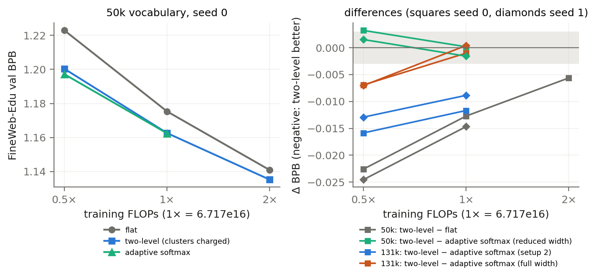
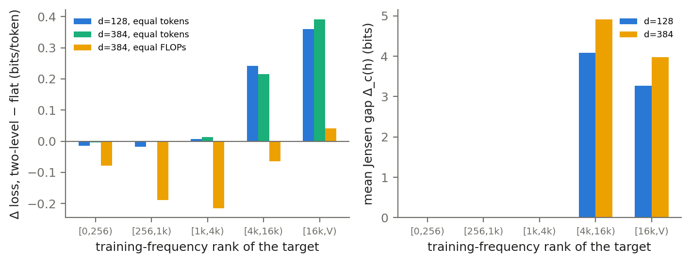

# Factorised Output Layers Let Small Language Models Use a 131k Vocabulary at Equal Compute

Jakub Michałek, independent researcher

*November 2026. Exported from `paper/main.tex` by `paper/export_md.py`; the PDF is the reference version.*

## Abstract

In small language models the output layer can take most of the training compute: at $d=384$ with a 131k vocabulary a flat
softmax head is 79.5% of training FLOPs. We compare output layers at equal training FLOPs, in bits per byte (BPB): a
flat head, an adaptive softmax, and a two-level head from the class-based family (8,192 frequent tokens with their own logits,
the other tokens in 4,096 $k$-means clusters with a within-cluster softmax; the cost of building the clusters is charged).

Both factorised heads beat the flat head. With either of them, the 131k model minus the best 50k model of our main comparison
is −0.0095 / −0.0092 BPB (two-level / adaptive softmax); with the flat head, 131k minus 50k is +0.0495. The usual reduced-width tail of adaptive softmax hurts here: scoring the tail at
full width changes its BPB by −0.0107 / −0.0093 (seeds 0 / 1), and it then ties the two-level head (two-level
minus adaptive softmax −0.0010 / +0.0004, a tie under a rule fixed before the run), with 108.1M parameters
(its tail is untied) against 62.5M.

Against the flat head, the two-level head trains at 1.98$\times$ (50k) and 4.29$\times$ (131k) the
tokens per second on our GPU, is +0.0115 BPB worse at equal tokens, and its equal-compute advantage at 50k roughly halves
per doubling of compute (0.5 to 2$\times$ the budget; seed 0). The 131k BPE is trained
on the training corpus and the 50k tokenizer is GPT-2's, so vocabulary size and domain change together. The compared models have
6 blocks and $d=384$, train on English FineWeb-Edu with one learning rate, and use 1–2 seeds. Code, logs and results:
<https://github.com/TG-TG-TG-TG-TG-TG/factorised-output-layers-let-small-language-models-use-a-131k-vocabulary-at-equal-compute>.

## Introduction

A flat softmax head costs $6dV$ training FLOPs per token for width $d$ and vocabulary $V$. The transformer body costs about
$6 \cdot 12 n d^2$ for $n$ blocks. The head's share is therefore large when $d$ is small or $V$ is large (Figure 1).
In our $d=384$, 6-block models it is 59.8% of training FLOPs with GPT-2's 50k vocabulary and 79.5% with a 131k
vocabulary. At ${\sim}600$M parameters with a 50k vocabulary it is 7%–14%, depending on the
shape (§6). Small models are where the head matters.

Tao et al. (2024) find that larger models want larger vocabularies. A small model
pays for a larger vocabulary mostly in the head. A two-level head lowers that cost to $6d(K + C' + \bar n)$, where $K$ is the
number of frequent tokens, $C'$ the number of tail clusters and $\bar n$ the cluster size: with $K = 8{,}192$ and $C' = 4{,}096$
this is 0.245$\times$ the flat head's FLOPs at $V = 50{,}257$ and 0.094$\times$ at $V = 131{,}072$. Under
a fixed compute budget the cheaper step buys more training tokens. We ask whether the model trained on those tokens ends up
better than a flat head and than an adaptive softmax, at two vocabulary sizes and three budgets.

**Prior work and novelty.** Factorising the softmax through word classes is old (Goodman, 2001; Morin and Bengio, 2005). The adaptive softmax (Grave et al., 2017) also keeps a shortlist of frequent words in the root and
is the closest prior work. We do not claim the architecture. Our contributions are:

1. An equal-compute comparison at small LM scale with a modern recipe (WSD schedules with decay branches, training FLOPs
  matched to within 0.5%, BPB across tokenizers), in which factorised output layers make a 131k vocabulary usable: the two-level
  head (cluster cost charged) and an adaptive softmax with full-width tail bands both beat the flat head, and at 131k both are below
  every $d=384$ 50k model of the main comparison at the same budget, while the flat head gets worse (§1).
2. The reduced-width tail of the standard adaptive softmax is what put it behind at 131k. Scoring the tail at full width
  changes its BPB by −0.0100 (2-seed mean), and it then ties the two-level head on two seeds, under a rule pinned before the run; the
  two-level head needs 62.5M parameters for this and the adaptive softmax 108.1M, whose tail is untied (§1;
  §1 lists what was decided after which result).
3. What the two-level head offers over a flat head besides BPB, and its limits: 1.98$\times$ and
  4.29$\times$ the training throughput (§2); at 50k it only ties adaptive softmax (§1);
  its advantage over the flat head roughly halves per doubling of compute between 0.5$\times$ and 2$\times$
  (§2); and it is worse at equal tokens (§3).
4. An ablation of the design choices (§4) and measurements beyond loss: out-of-domain text, grammar
  (BLiMP), rare words (LAMBADA), in-context copying and stored knowledge (§2).

The throughput numbers are from a benchmark of the training step on our GPU, with no rule pinned. We make no speed comparison
with adaptive softmax.

*Figure 1: Left: head share of training FLOPs against model width (cost model of §3; 6 blocks, $f = 4d$, context
1,024). Right: the two-level head.*

## Background and related work

**Factorised and approximate softmax.** Class-based models predict a class and then a word within it
(Goodman, 2001); hierarchical softmax extends this to a tree (Morin and Bengio, 2005). The adaptive softmax
(Grave et al., 2017) sizes the clusters by frequency, puts the frequent words in the root, and shrinks the projection of
rare clusters so the computation suits GPUs. Adaptive input representations (Baevski and Auli, 2019) apply the same frequency
bands to the input embedding. Chen et al. (2016) compare softmax approximations for large-vocabulary language models,
including hierarchical and differentiated softmax and sampling-based training. Sampled softmax (Jean et al., 2015) trains
against a sampled subset of the vocabulary. Our head is a two-level class-based softmax with one
frequent shortlist, many small equal-size tail clusters chosen by $k$-means on trained embeddings, and tied embeddings
throughout. Its exact normalisation makes sampling and greedy decoding exact (§3).

**The head as a bottleneck.** A flat head over $d$-dimensional states can only express log-probability matrices of rank
about $d$ (Yang et al., 2018). Godey et al. (2024) link small-model saturation to this bottleneck, and
Godey and Artzi (2026) argue that the head also limits the gradient that reaches the body. Our results are about compute, not
expressivity.

**Vocabulary size.** Tao et al. (2024) study how the optimal vocabulary grows with compute. They find that larger
models want larger vocabularies, and that many models use too small a vocabulary. A cheaper head lowers the cost side of that
trade-off.

**Knowledge capacity.** Allen-Zhu and Li (2024) measure how many bits of synthetic biographical knowledge a model
stores per parameter (about 2 bits/param at 1,000 exposures). Allen-Zhu (2025) use 100 exposures per biography in
their Capo task. We use a synthetic-biography test in that spirit, also at 100 exposures, to ask whether the two-level head costs
stored knowledge.

**Training and data.** We use the warmup–stable–decay (WSD) schedule (Hu et al., 2024), which lets many token
budgets share one run. Training data is FineWeb-Edu (Penedo et al., 2024). Out-of-domain sets are WikiText-103
(Merity et al., 2017) and PG-19 (Rae et al., 2019). We also evaluate BLiMP (Warstadt et al., 2020) and LAMBADA
(Paperno et al., 2016).

## Method

**Two-level head.** Let $h \in \mathbb{R}^d$ be the final hidden state and $u_w$ the (tied) embedding of token $w$. The
frequent set $F$ holds the $K$ tokens most often seen as targets in the training stream. Every other token belongs to exactly one
tail cluster $c(w) \in \{1, \dots, C'\}$. The top-level softmax runs over the $K + C'$ entries
$\{u_w \cdot h\}_{w \in F} \cup \{z_c(h)\}_c$:

$$p(w \mid h) = \begin{cases} p_{\text{top}}(w \mid h) & w \in F,\\ p_{\text{top}}(c(w) \mid h)\; p(w \mid c(w), h) & \text{otherwise},\end{cases} \qquad p(w \mid c, h) = \frac{\exp(u_w \cdot h)}{\sum_{v \in c} \exp(u_v \cdot h)}.$$

We use $K = 8{,}192$ and $C' = 4{,}096$ throughout. The cluster logit is $z_c(h) = (\bar u_c + R_c) \cdot h + b_c$, where
$\bar u_c$ is the mean embedding of $c$'s members and $R_c$, $b_c$ are a learned residual and bias. This tied-mean form is an
implementation detail: in the ablation it is within noise of a free cluster vector (§4).

**Clusters, and their cost.** Tail clusters are built by balanced $k$-means (capacity $\lceil (V - K)/C' \rceil$) on the
trained embedding rows of a cheap flat proxy model ($d=128$, the same data order). For the 50k head the proxy trains on
55M tokens and costs $2.77\times10^{15}$ FLOPs, 4.1% of the main budget; for the 131k head it trains on
50M tokens of the 131k tokenizer and costs $6.18\times10^{15}$ FLOPs, 9.2%. Unless stated otherwise the proxy's FLOPs are
charged: the two-level model is trained to the budget minus the proxy's cost. The frequent set needs only target counts and
costs nothing.

**Cost model.** Per training token, the flat head costs $6dV$ FLOPs. The two-level head costs $6d(K + C') + 6d\bar n$:
the top-level logits plus one cluster of $\bar n$ members. The clusters have $\bar n = 11$ members at 50k and 30 at 131k, so the
head-FLOP ratio is 0.245 and 0.094.

**Exact decoding.** Writing $p(c \mid h)$ for the top-level probability of cluster $c$ (a frequent token is a singleton
cluster), three facts follow directly from the definition. They are standard for class-based softmax and are stated only
because the implementation relies on them.

**Remark 1 (exact sampling).**
$p(w \mid h) = p(c(w) \mid h)\, p(w \mid c(w), h)$, so drawing a top-level entry and then, if it is a cluster, a member is an
exact sample from $p(\cdot \mid h)$.

**Remark 2 (exact greedy).**
$p(w \mid h) \le p(c(w) \mid h)$, because $p(w \mid c, h) \le 1$. So visiting clusters in decreasing $p(c \mid h)$ and stopping
once $p(c \mid h)$ is at most the best $p(w \mid h)$ found returns the exact argmax.

 The implementation evaluates all frequent tokens and the three most likely clusters, and falls back to the full
distribution when the stopping test fails. On the trained 131k model it has exact-match rate 1.0000 against the full
argmax on 4,096 positions and expands 10.0 clusters on average (fallback rate 0.17%).

**Remark 3 (cluster means).**
$\log p(w \mid c, h)$ does not change when the same vector is added to every $u_w$, $w \in c$. So the within-cluster loss has zero
gradient along the cluster's mean embedding, and only the top-level term moves it.

**Adaptive-softmax baseline.** Our adaptive softmax keeps the two-level head's 8,192 frequent tokens as its shortlist,
tied to the input embedding, and adds one logit per tail band to the root. The tail is split by training frequency into two bands.
Each band has its own untied low-rank layer: the hidden state is projected to $d/4 = 96$ (first band) or $d/16 = 24$ (second
band) dimensions and scored against the band's own output embeddings. The reduction factor of 4 per band was fixed before any run. The cutoffs are ranks $(8{,}192,\ 24{,}576)$ at 50k. At 131k we ran two setups: setup 1 uses
the same cutoffs, and setup 2 moves the second cutoff to 49,152, so that its last band holds about the same share of training
targets as at 50k. Setup 2 was chosen after setup 1's seed-0 result was known (§1). A third setup,
*full width*, keeps setup 2's cutoffs and changes only the tail width: there is no projection, and each tail band scores the
hidden state directly against its own untied 384-dimensional output embeddings. It was added after an outside review, once
every other 131k result was known (§1). No setup was tuned further: no other cutoffs, initialisations or
learning rates were tried, and the tail was never tied to the input embedding. The baseline differs from
Grave et al. (2017) in tying the shortlist to the input embedding and in fixing the shortlist to the two-level head's
frequent list. Its FLOPs are charged as its training algorithm runs: the root for every token, and each band only for the targets
that fall in it, weighted by that band's share of training targets. This favours the baseline (our 50k implementation computes
every band for every token). Training FLOPs per token are 97.8M at 50k (head share 20.4%) and 98.5M /
99.8M / 113.2M at 131k (setups 1 / 2 / full width; full width: head share 31.2%), against 106.2M for
the two-level head and 193.8M for the flat 50k head. At equal FLOPs the full-width setup therefore trains on fewer tokens than
setups 1–2 (594M), but still on more than the charged two-level head (574M).

## Experimental setup

**Models.** Pre-norm decoder-only transformers with 6 blocks, RMSNorm, RoPE, GELU MLPs ($f = 4d$), tied input/output
embeddings and context length 1,024. Two widths: $d=128$ (2 heads) and $d=384$ (6 heads). Parameter counts at $d=384$:
29.9M (flat), 31.5M (two-level) and 32.2M (adaptive softmax) with the 50k vocabulary; 60.96M,
62.54M, 65.1M, 66.9M and 108.1M (flat, two-level, adaptive-softmax setups 1, 2 and full
width) with 131k. Most of each count is the input embedding; the full-width adaptive softmax adds 47.2M of head
parameters, mostly its untied tail output embeddings.

**Output layers compared.** *Flat*: a tied softmax over all $V$ tokens. *Two-level*: the head of
§3, clusters from the cheap proxy, proxy FLOPs charged. *Two-level, old clusters*: the same head with 50k
clusters taken from a full-budget $d=128$ flat model whose cost was not charged; it was used for the small-vocabulary,
equal-token, downstream and speed measurements (§3, §3, §2,
§2), which predate the charged runs. *Adaptive softmax*: the baseline of
§3. Appendix E maps every run name to these arms.

**Data and tokenizers.** FineWeb-Edu (sample-10BT) is streamed in a fixed document order with seed 0. All models see the
same stream. Validation is a fixed set of 23,160,213 UTF-8 bytes. Tokenizers: GPT-2 (50,257 tokens, 4.633 bytes/token), and
byte-level BPE with 4,096 / 8,192 / 131,072 tokens. Each BPE tokenizer is trained on the first 2.0 GB of the training stream with
GPT-2 pre-tokenisation (3.473, 3.933 and 4.944 bytes/token). Round trips are exact on all validation documents.
We compare models by bits per byte: GPT-2 models from their logged validation loss, BPE models with a byte-aligned evaluator that
scores every byte. The two agree within $2\times10^{-5}$ BPB on GPT-2 models.

**Schedule and budget.** AdamW ($\beta = (0.9, 0.95)$, weight decay 0.1, clip 1.0), peak learning rate $2\times10^{-3}$
for every arm, 65,536 tokens per step. WSD schedule: a 3M-token warmup and a constant phase, then decay branches forked at chosen
token counts. Each branch decays linearly to $0.1\times$ the peak LR over 10% of the steps so far. A budget's FLOPs count the
stable and the decay tokens. Per-token training FLOPs are $6\times$(block matmuls) $+$ causal attention scores $+$ the head
(flat: $6dV$; two-level: $3\times$ its forward FLOPs; adaptive softmax: as above). The main budget (1$\times$) is $6.717\times10^{16}$
FLOPs; we also use 0.5$\times$ ($3.505\times10^{16}$) and 2$\times$ ($1.343\times10^{17}$). Every compared branch is within 0.5% of its
budget.

**Hardware.** One RTX 5070 Ti (16 GB), JAX, bf16 compute. In `jax.lax.ragged_dot` the grouped matmul lowers to a
dense product on this GPU, so the two-level head uses a gather-based path (§6).

**Protocol.** Every decision rule was written in the analysis script's docstring, with a date, before
the runs it depends on. Each result below says whether its rule was pinned in advance; results without a pinned rule are labelled
observations. A difference within $\pm 0.003$ BPB is called a tie. Every number in this paper is generated from the results files
by `paper/make_numbers.py`. Two steps of the 131k comparison were decided after some results were known, and we state
them here. (i) Adaptive-softmax setup 2 was added after setup 1's seed-0 result was known (two-level minus setup 1:
−0.0223 BPB); its cutoffs were fixed before any setup-2 run. (ii) The pinned rule first compared seed 1 against the
seed-0 winner's setup, which had no seed-1 run. We then pinned, before running it, the rule that seed 1 is compared against the
better adaptive softmax on seed 1. At that point the two-level and setup-1 seed-1 results were known. This rule is at least as
strict as the original one. (iii) The full-width setup was added after that rule had passed and the paper had been written
around it, at an outside reviewer's request, with every other 131k result known. Its rule and what each outcome would do to the
paper were pinned before its first run: a PASS would keep the earlier title, which claimed that the two-level head makes the
131k vocabulary pay off; a tie or a loss would remove that claim. Seed 0 fell inside the band where the rule asks for a second
seed, and both seeds gave a tie, so the claim was removed and the paper rewritten as it stands. Both 131k two-level seeds use the same proxy clusters, and so do both 50k seeds, so the seed spreads
do not include the variance of building the clusters.

## Results

Table 1 gives every head comparison at the main budget, and Figures 2 and 3 plot them.

\small

| vocabulary | output layer | seed | 0.5$\times$ | 1$\times$ | WikiText-103 (1$\times$) | PG-19 (1$\times$) |
|---|---|---|---|---|---|---|
| 50k | flat | 0 | 1.2229 | 1.1753 | – | – |
| 50k | flat | 1 | 1.2240 | 1.1763 | – | – |
| 50k | adaptive softmax | 0 | 1.1972 | 1.1624 | – | – |
| 50k | adaptive softmax | 1 | 1.1980 | 1.1632 | – | – |
| 50k | two-level | 0 | 1.2003 | 1.1626 | – | – |
| 50k | two-level | 1 | 1.1995 | 1.1616 | – | – |
| 131k | flat | 0 | 1.3026 | 1.2248 | 1.5094 | 1.7912 |
| 131k | adaptive softmax, setup 1 | 0 | 1.2052 | 1.1735 | 1.4370 | 1.7384 |
| 131k | adaptive softmax, setup 1 | 1 | 1.2054 | 1.1738 | 1.4395 | 1.7374 |
| 131k | adaptive softmax, setup 2 | 0 | 1.1963 | 1.1629 | 1.4292 | 1.7179 |
| 131k | adaptive softmax, setup 2 | 1 | 1.1964 | 1.1628 | 1.4260 | 1.7219 |
| 131k | adaptive softmax, full width | 0 | 1.1874 | 1.1522 | 1.4166 | 1.7228 |
| 131k | adaptive softmax, full width | 1 | 1.1905 | 1.1536 | 1.4204 | 1.7210 |
| 131k | two-level | 0 | 1.1804$^\dagger$ | 1.1512 | 1.4063 | 1.6834 |
| 131k | two-level | 1 | 1.1835$^\dagger$ | 1.1539 | 1.4130 | 1.6879 |

*Table 1: FineWeb-Edu validation BPB ($d=384$) at 0.5$\times$ and 1$\times$ the main budget of $6.717\times10^{16}$ training FLOPs,
and out-of-domain BPB at 1$\times$. Two-level rows are charged with the proxy's FLOPs, except $^\dagger$: the 131k two-level
0.5$\times$ points are uncharged (no charged 0.5$\times$ branch was saved; the proxy would be twice as large a share of that
budget as at 1$\times$).*

### 50k vocabulary: two-level and adaptive softmax tie (2 seeds; pinned)

At 1$\times$ the flat head reaches 1.1753 / 1.1763 BPB (seeds 0 / 1) on 347M tokens, and the
two-level head 1.1626 / 1.1616 on 606M tokens. Two-level minus flat is −0.0127 / −0.0147,
mean −0.0137 BPB; the pinned rule (mean $\le -0.003$ and both seeds negative) holds. The seed spreads are 0.0010
(flat) and 0.0010 (two-level).

The adaptive softmax reaches 1.1624 / 1.1632 on 687M tokens: it is cheaper per token than the two-level
head under our accounting, so it sees more tokens. Two-level minus adaptive softmax is +0.0001 / −0.0016, mean
−0.0007: a tie under the pinned rule. At 0.5$\times$ it is +0.0023 (2 seeds, reported only), also a tie. Adaptive
softmax minus flat is −0.0130 at 1$\times$. At 50k, then, the gain over the flat head comes from factorising the softmax,
and the two-level head does not add to it. The 50k adaptive softmax has the reduced-width tail (96 / 24); a full-width tail was
run only at 131k.

*History.* An earlier draft reported −0.0204 BPB against the flat head, with old clusters whose cost was not
charged. Rebuilding the clusters from the cheap proxy changes the two-level result by +0.0048 BPB before charging (2-seed means), and charging the proxy's FLOPs gives the −0.0137 above.

### 131k vocabulary: both factorised heads make it usable (2 seeds)

*Against the full-width adaptive softmax (pinned).* At 1$\times$ the full-width adaptive softmax reaches 1.1522 /
1.1536 BPB (seeds 0 / 1) and the two-level head 1.1512 / 1.1539. Two-level minus full width is −0.0010 /
+0.0004, which is  a tie  under the rule pinned before the run
(§1). The full-width model has 108.1M parameters against 62.5M for the two-level model (its tail is untied; tying
it was not tried, §6), and
it trains on 594M tokens against 574M.

*Against the reduced-width setups (pinned, before the full-width run).* Two-level minus the better of setups 1 and 2 is
−0.0117 / −0.0089, which passes the rule pinned for it (both below $-0.003$). Setup 2 is the better one on both seeds;
setup 2 minus setup 1 is −0.0106 / −0.0110, and two-level minus setup 1 is −0.0223 / −0.0198. The
full-width run shows where that lead came from: full width minus setup 2 is −0.0107 / −0.0093 (reported, not part
of the pinned rule). With the same cutoffs, scoring the tail through 96- and 24-dimensional projections cost the adaptive
softmax about as much as its whole gap to the two-level head.

*Against the flat head* (seed 0; the flat 131k model has one seed), two-level minus flat is −0.0736 and full width
minus flat is −0.0726. The flat model trains on only 177M tokens.

*The vocabulary contrast* (Figure 2; observations, no rule pinned). Going from 50k to 131k at 1$\times$ changes

- the two-level model by −0.0095 BPB (seeds −0.0114 / −0.0077), from 1.1621 to 1.1526;
- the adaptive softmax by +0.0000 with setup 2's reduced-width tail (seeds +0.0005 / −0.0004; setup 1 by
  +0.0108), from 1.1628 to 1.1629, and by −0.0099 with the full-width tail, to 1.1529 (the 50k
  adaptive softmax has the reduced-width tail, so this step also changes the width);
- the flat model by +0.0495 (seed 0).

With either factorised head the 131k model is better than the best 50k model of the main comparison at this budget: 131k
minus that model is −0.0095 (two-level) and −0.0092 (full-width adaptive softmax; 2-seed means). This does not cover every 50k model
we trained: an earlier two-level run with a wider body ($d=512$, old clusters, uncharged, seed 0) reaches 1.1519 at
the same FLOPs. The flat head spends 79.5% of its FLOPs on the head at 131k
and loses tokens. Both factorised heads keep the head cheap, but the adaptive softmax gains from the larger vocabulary only once
its tail is scored at full width. This fits the idea that rare tokens need full-width output vectors, which every two-level tail
token has through its tied embedding; we did not test it further, and at 50k the full-width tail was not run.
The contrast also mixes two changes: the 50k vocabulary is GPT-2's tokenizer, while the 131k one is a BPE trained on FineWeb-Edu
itself, so the larger vocabulary is also better matched to the domain. Every head gets the same tokenizer change, so the
comparison between heads holds, but how much of the 131k gain comes from size and how much from domain match is not separated
(§6).

*Out of domain* (observations, no rule pinned), the two-level head leads the full-width adaptive softmax on both seeds:
two-level minus full width is −0.0104 / −0.0073 on WikiText-103 and −0.0394 / −0.0331 on PG-19
(against setup 2: −0.0229 / −0.0129 and −0.0345 / −0.0339; Table 1). We report these
leads but make no claim from them. Against the flat 131k model (seed 0) the two-level model, at the uncharged 1$\times$ point,
scores 74.86% vs 70.01% on BLiMP and 13.16% vs 10.34% on LAMBADA (observations).

*Figure 2: Left: FineWeb-Edu BPB at $6.717\times10^{16}$ training FLOPs against vocabulary size ($d=384$). Two-seed means where two seeds
exist (flat 50k, adaptive softmax, two-level); flat 4k, 8k and 131k are seed 0. Two-level points are charged with the proxy.
The hollow diamond is the full-width adaptive softmax at 131k; it ties the two-level point it covers. Right: head share of
training FLOPs (adaptive softmax charged by band share).*

### The advantage shrinks with compute (1–2 seeds; pinned)

At 50k, two-level minus flat (charged, seed 0) is −0.0226 at 0.5$\times$, −0.0127 at 1$\times$ and −0.0056 at 2$\times$
(Figure 3); the 2-seed means at 0.5$\times$ and 1$\times$ are −0.0236 and −0.0137. The advantage roughly
halves per doubling. Uncharged, the three values are −0.0278, −0.0146 and −0.0067. The 2$\times$ point has one
seed; its run's 1$\times$ branch reproduces the flat 1$\times$ result (difference −0.0003 BPB). Two readings of these three points
are possible, and we cannot tell them apart.

- *Linear in $\log F$.* A least-squares line has slope +0.0085 BPB per doubling and crosses zero near
  3.1$\times$ ($2.1\times10^{17}$ FLOPs). This is an extrapolation from three points, not a result.
- *Keeps halving.* The advantage stays negative but soon falls inside our $\pm0.003$ tie band.

At 131k the lead over setup 2 also shrinks, from −0.0158 / −0.0129 at 0.5$\times$ to −0.0117 / −0.0089
at 1$\times$, and over the full-width adaptive softmax from −0.0069 / −0.0071 to the tie at 1$\times$
(observations). The 0.5$\times$ two-level points are uncharged, which favours them, so part of this shrinkage is the proxy
charge. At 131k we have no budget beyond 1$\times$. At 50k the two-level head minus adaptive softmax moves from +0.0023 to
−0.0007, a tie at both budgets.

*Figure 3: Left: 50k FineWeb-Edu BPB against training FLOPs (seed 0; two-level charged). Right: differences, two-level minus
baseline; the grey band is the $\pm0.003$ tie band. The 50k adaptive softmax has the reduced-width tail; the 131k lines
compare against setup 2 and against the full-width setup. The 131k 0.5$\times$ two-level points are uncharged.*

### Small vocabularies (1 seed; pinned)

Could a flat head instead save compute with a smaller vocabulary? At 1$\times$ a flat 8k-vocabulary model reaches 1.1875 BPB
and a 4k model 1.2056, against 1.1559 for the two-level head with old clusters: differences −0.0315 and
−0.0497. The charged two-level head (1.1621, 2 seeds) is also below both. Shrinking the vocabulary costs
more than it saves.

### Equal tokens (1 seed; pinned)

At equal *tokens* the picture reverses. At 300M tokens, two-level (old clusters) minus flat is +0.0115 BPB ($d=384$), and at $d=128$ and 1.2B tokens it is +0.0101 BPB: the two-level head is worse. The two-level head wins at equal compute
only because each step is cheaper and it sees more tokens. A practitioner limited by data rather than compute should keep the flat
head.

**A hypothesis for the equal-token gap.** The gap sits in rare targets: at $d=128$ it is +0.24 bits/token
for targets of frequency rank $[4\text{k}, 16\text{k})$ and +0.36 for ranks $\ge 16$k, and near zero for frequent
targets (Figure 4).

**Remark 4 (Jensen gap).**
Write $s_w = u_w \cdot h$ and $n_c = |c|$. The exact log-mass of cluster $c$ is $\mathrm{LSE}_{w \in c}(s_w) = \log n_c +
\frac{1}{n_c}\sum_{w \in c} s_w + \Delta_c(h)$ with $\Delta_c(h) \ge 0$, by Jensen's inequality for $\exp$; $\Delta_c(h) = 0$ iff
all $s_w$ in $c$ are equal.

 A cluster logit that is linear in $h$ can learn the average of $\log n_c + \Delta_c(h)$ but not its dependence on $h$.
The gap is largest when one member stands out, for example a token the context makes likely. On validation text the mean gap for
tail targets is 3.70 bits at $d=128$, and 4.95 bits on the second copy of a repeated
window. This is consistent with the rare-target gap but does not establish it, and the measurement was not pinned. Exact
re-scoring of the top 16 clusters, which removes the gap for those clusters, does not close the equal-token gap
(§4), but it covers the target's cluster for only 43% of tail targets, so it is not a clean test. An
untested alternative is that tail tokens receive fewer effective gradient updates: within-cluster gradients reach only the
target's cluster.

*Figure 4: Left: loss difference (two-level minus flat, bits/token) by training-frequency rank of the target, FineWeb-Edu
validation. Right: mean Jensen gap $\Delta_c(h)$ of the target's cluster by rank, in bits (observation).*

### Ablation of the design (1–2 seeds; observation)

Table 2 changes one thing at a time, at $d=128$ and equal tokens (1.2B stable tokens), from runs made before
this table was assembled. Where two seeds exist their spread is 0.0002–0.0009 BPB, so a one-seed difference
under about 0.002 is not distinguishable. Clustering by $k$-means instead of at random changes BPB by −0.0572, and adding 4,096 frequent singletons by −0.0107. The tied-mean cluster logit is within noise (+0.0004 and −0.0014), as are 4,096 instead of
1,024 clusters (−0.0001). Exact re-scoring of the 16 most likely clusters gives −0.0015; its pinned two-seed test,
−0.0012 / −0.0019 BPB (seeds 0 / 1), gave the verdict “no help”. At $d=384$ re-scoring changes BPB by −0.0029 (1 seed, observation) at about $2\times$ the wall-clock per step. Because the rows are at equal tokens, the final head minus the flat head is still +0.0103 BPB here.

\small

| row | vs | seeds | BPB | $\Delta$ BPB vs row | training FLOPs |
|---|---|---|---|---|---|
| (a) flat head | – | 2 | 1.2835 | – | $6.66\times10^{16}$ |
| (b) 1,024 random clusters | – | 1 | 1.3694 | – | $1.67\times10^{16}$ |
| (c) 1,024 $k$-means clusters | (b) | 1 | 1.3122 | −0.0572 | $1.67\times10^{16}$ |
| (d) (c) + tied-mean cluster logit | (c) | 1 | 1.3125 | +0.0004 | $1.67\times10^{16}$ |
| (e) (c) + 4,096 frequent singletons | (c) | 1 | 1.3015 | −0.0107 | $2.08\times10^{16}$ |
| (f) (e) + tied-mean cluster logit | (e) | 1 | 1.3000 | −0.0014 | $2.08\times10^{16}$ |
| (g) (f) with 8,192 singletons | (f) | 2 | 1.2957 | −0.0043 | $2.50\times10^{16}$ |
| (h) (f) with 4,096 clusters | (f) | 1 | 1.2999 | −0.0001 | $2.39\times10^{16}$ |
| (i) (g) with 4,096 clusters: final head | (g) | 2 | 1.2938 | −0.0018 | $2.80\times10^{16}$ |
| (j) (i) + exact re-scoring, 16 clusters | (i) | 2 | 1.2923 | −0.0015 | $2.82\times10^{16}$ |

*Table 2: Design ablation at $d=128$, equal tokens (1.2B stable tokens plus decay), FineWeb-Edu BPB; two-seed means where two seeds
exist. $\Delta$ is this row minus the row in “vs”. Row (b) has free cluster vectors and no frequent list.*

### Beyond loss (1–2 seeds)

These measurements use the 50k two-level model with old clusters, which is slightly better than the charged one
(§1), so they slightly favour the two-level head. The main comparison is against the FLOP-matched flat model.
Several pinned rules were written against a flat model with 5% fewer FLOPs; those results are in footnotes.

**Out of domain (1 seed; observation).** Two-level minus flat is −0.0187 BPB on WikiText-103 and −0.0248 on
PG-19.\footnote{Pinned rule, flat at $6.39\times10^{16}$ FLOPs: −0.0308 and −0.0254 (holds).} At equal tokens it is
+0.0074 and +0.0076.

**Grammar (2 seeds; pinned).** BLiMP accuracy is 72.06% for the two-level head and 71.68% for the
FLOP-matched flat model (seed 0; observation). The pinned two-seed differences, −0.09 points at equal tokens and
+0.70 points against the flat model with 5% fewer FLOPs, are inside the pinned $\pm1$-point band: no difference in
grammar.[^1] Flat 8k minus two-level is −2.07 points.

**Rare words (1 seed; pinned).** LAMBADA was run only against the flat model with 5% fewer FLOPs. There the two-level
head is close to the flat head (accuracy 14.1% vs 14.8%), and the flat 8k model is much better (16.8%). Whole-passage
BPB on the LAMBADA texts is nearly equal (8k minus two-level: +0.0206). The 8k model's advantage on the last word is
+0.383 bits/byte when the word appears earlier in the passage (4,201 of 5,153 passages), against
−0.036 otherwise; the pinned verdict is “real effect”. In the examples we inspected, the target is a rare name that
occurs earlier in the passage: GPT-2's vocabulary has it as one rare token, while the 8k vocabulary splits it into pieces that are
cheap to copy (observation). So the LAMBADA difference is a tokenizer effect, not a head effect.

**In-context copying (1 seed; pinned).** On a 512-token validation window repeated once, the two-level head's gap on rare
targets ($\ge 4{,}096$) at equal tokens is +0.28 bits/token on the first copy and +0.35 on the second:
the gap does not shrink when the answer is in context, which is consistent with the Jensen-gap hypothesis. Against the flat model with 5%
fewer FLOPs it is −0.01 and −0.07. On random rare-token lists repeated once, two-level minus flat on
the second copy is −2.12 bits/token against that flat model and +0.44 at equal tokens. No
FLOP-matched copying run exists.

**Knowledge (synthetic biographies, $d=128$; 1–2 seeds; pinned).** At equal exposures (100 per biography) the two-level
head stores 1.105$\times$ (20k people) and 1.015$\times$ (100k people) the bits of the flat head, so
there is no knowledge penalty under the pinned $\ge 0.95$ rule (1 seed). At equal FLOPs it sees 237.4 exposures instead of
100.0 and stores 1.708$\times$ (seed 0) and 2.217$\times$ (seed 1) the bits; the pinned
two-seed rule ($\ge 1.2$ at both seeds)  holds. The cluster cost is not charged here: the
bios models reuse the FineWeb-Edu clusters of the old-cluster model, built from the output vectors of a flat $d=128$ run whose
training took 2.4$\times$ the flat bios run's FLOPs. The gain comes from the extra exposures the cheaper head
buys; at equal exposures the two heads are about level. These models are not at capacity: bits still grow
with the population, so this measures stored bits for a fixed budget, not a capacity limit.

### Wall-clock and decoding against the flat head (1 seed; reported)

On this machine the full 1$\times$ run took 32.1 min for the two-level head (old clusters) and 35.7 min for the
FLOP-matched flat head. Batch-1 decoding takes 0.203 vs 0.279 ms/token (0.73$\times$; random bf16 weights,
KV cache). A benchmark of the training step alone (Appendix F; no rule pinned) gives 1.98$\times$ the
flat head's tokens/s with a 50k vocabulary and 4.29$\times$ with 131k, at 16 rows of 1,024 tokens. We make no
wall-clock comparison with adaptive softmax: its 50k runs used a dense implementation that computes every band for every
token, and we did not optimise either factorised head for this GPU.

## Limitations

- **Scale.** The compared models have 6 blocks and $d \le 384$ (the appendix also lists one $d=512$ run and
  earlier body variants), at most 108.1M parameters (the full-width 131k adaptive softmax; 66.9M for
  setup 2 and 62.5M for the flat and two-level 131k models, most of it embeddings), and at most $1.343\times10^{17}$
  training FLOPs, 2$\times$ the main budget. At 131k nothing ran past 1$\times$.
- **One learning rate.** Every arm, adaptive softmax included, uses the peak LR $2\times10^{-3}$. A per-head LR could
  change the ranking.
- **Adaptive softmax, untuned.** At 131k we ran three setups: two cutoff settings with the reduced-width tail (96 and
  24 at $d=384$) and setup 2's cutoffs at full width. At 50k we ran one, with the reduced-width tail. The full-width tail is untied;
  tying it to the input embedding would remove nearly all of its 47.2M head parameters, and was not tried. Neither were
  other cutoffs, widths between 24 and 384, or a full-width tail at 50k.
- **Equal FLOPs, not equal parameters.** The two-level and full-width adaptive-softmax models tie in BPB at different
  sizes (62.5M and 108.1M). We compare at equal training FLOPs; memory and parameter count are reported, not
  matched.
- **Tokenizer.** The 50k vocabulary is GPT-2's tokenizer and the 131k one is a BPE trained on FineWeb-Edu, so going
  from 50k to 131k changes vocabulary size and domain match together. A 50k BPE trained on FineWeb-Edu was not tested.
- **Seeds.** One or two seeds per claim; the seed count is given with each result. The two 131k two-level seeds share
  their clusters.
- **Data.** One dataset (FineWeb-Edu), English only.
- **The advantage shrinks with compute.** Beyond 2$\times$ the budget we cannot say whether it stays negative.
- **The win depends on the head's share of FLOPs.** The flat head's share is $6dV / (6 \cdot 12nd^2 + 6nTd + 6dV)$.
  At ${\sim}600$M parameters with a 50k vocabulary it is 7.3% ($d=1024$, 48 blocks), 9.3% ($d=1280$, 30),
  11.4% ($d=1536$, 20) or 14.1% ($d=2048$, 12), so the expected gain there is small. With a 131k vocabulary it
  is 17.0%–29.9%.
- **The equal-token gap.** At equal tokens the two-level head is worse (+0.0115 BPB at $d=384$).
- **Downstream measurements** use the old-cluster 50k model, and several were pinned against a flat model with 5%
  fewer FLOPs. The biographies are synthetic and the bios models are not at capacity. The equal-FLOP bios comparison does not
  charge the clusters, which took 2.4$\times$ that experiment's flat budget to build.
- **GPU-specific kernels.** `ragged_dot` lowers to a dense product on this GPU, so we use a gather path.
  Wall-clock numbers may differ on other GPUs.

## Conclusion

At our scale and under a fixed training budget, a factorised output layer lets a small model use a 131k vocabulary. With a
two-level head (cluster cost charged) or an adaptive softmax whose tail is scored at full width, the 131k model beats the $d=384$
50k models of our main comparison at the same budget, while with a flat head the larger vocabulary makes the model worse. Scoring the adaptive-softmax tail at
full width instead of through the usual reduced-width projections changes its BPB by −0.0100 here, and it then ties the
two-level head, which reaches the same BPB with 62.5M parameters instead of 108.1M (the adaptive softmax's tail is untied). At 50k the two-level head only ties a reduced-width adaptive
softmax, and its advantage over the flat head shrinks as the budget grows. A factorised head is not a free lunch per token: when
data, not compute, is the limit, or when the head is a small share of FLOPs (large $d$, small $V$), keep the flat head.

**Acknowledgements.** Experiment design, code and drafting were assisted by AI models (Claude).

## References

- Allen-Zhu, Zeyuan (2025). Physics of Language Models: Part 4.1, Architecture Design and the Magic of Canon Layers. Advances in Neural Information Processing Systems (NeurIPS)
- Allen-Zhu, Zeyuan, Li, Yuanzhi (2024). Physics of Language Models: Part 3.3, Knowledge Capacity Scaling Laws. arXiv preprint arXiv:2404.05405
- Baevski, Alexei, Auli, Michael (2019). Adaptive Input Representations for Neural Language Modeling. International Conference on Learning Representations (ICLR)
- Chen, Wenlin, Grangier, David, Auli, Michael (2016). Strategies for Training Large Vocabulary Neural Language Models. Proceedings of the 54th Annual Meeting of the Association for Computational Linguistics (ACL)
- Godey, Nathan, Artzi, Yoav (2026). Lost in Backpropagation: The LM Head is a Gradient Bottleneck. Conference on Language Modeling (COLM)
- Godey, Nathan, de la Clergerie, Éric, Sagot, Benoít (2024). Why do small language models underperform? Studying Language Model Saturation via the Softmax Bottleneck. arXiv preprint arXiv:2404.07647
- Goodman, Joshua (2001). Classes for Fast Maximum Entropy Training. Proceedings of the IEEE International Conference on Acoustics, Speech, and Signal Processing (ICASSP)
- Grave, Édouard, Joulin, Armand, Cissé, Moustapha, Grangier, David, Jégou, Hervé (2017). Efficient softmax approximation for GPUs. Proceedings of the 34th International Conference on Machine Learning (ICML)
- Hu, Shengding, Tu, Yuge, Han, Xu, He, Chaoqun, Cui, Ganqu, Long, Xiang, others (2024). MiniCPM: Unveiling the Potential of Small Language Models with Scalable Training Strategies. arXiv preprint arXiv:2404.06395
- Jean, Sébastien, Cho, Kyunghyun, Memisevic, Roland, Bengio, Yoshua (2015). On Using Very Large Target Vocabulary for Neural Machine Translation. Proceedings of the 53rd Annual Meeting of the Association for Computational Linguistics and the 7th International Joint Conference on Natural Language Processing (ACL-IJCNLP)
- Merity, Stephen, Xiong, Caiming, Bradbury, James, Socher, Richard (2017). Pointer Sentinel Mixture Models. International Conference on Learning Representations (ICLR)
- Morin, Frederic, Bengio, Yoshua (2005). Hierarchical Probabilistic Neural Network Language Model. Proceedings of the Tenth International Workshop on Artificial Intelligence and Statistics (AISTATS)
- Paperno, Denis, Kruszewski, Germán, Lazaridou, Angeliki, Pham, Ngoc Quan, Bernardi, Raffaella, Pezzelle, Sandro, Baroni, Marco, Boleda, Gemma, Fernández, Raquel (2016). The LAMBADA dataset: Word prediction requiring a broad discourse context. Proceedings of the 54th Annual Meeting of the Association for Computational Linguistics (ACL)
- Penedo, Guilherme, Kydlícek, Hynek, Ben Allal, Loubna, Lozhkov, Anton, Mitchell, Margaret, Raffel, Colin, Von Werra, Leandro, Wolf, Thomas (2024). The FineWeb Datasets: Decanting the Web for the Finest Text Data at Scale. arXiv preprint arXiv:2406.17557
- Rae, Jack W., Potapenko, Anna, Jayakumar, Siddhant M., Lillicrap, Timothy P. (2019). Compressive Transformers for Long-Range Sequence Modelling. arXiv preprint arXiv:1911.05507
- Tao, Chaofan, Liu, Qian, Dou, Longxu, Muennighoff, Niklas, Wan, Zhongwei, Luo, Ping, Lin, Min, Wong, Ngai (2024). Scaling Laws with Vocabulary: Larger Models Deserve Larger Vocabularies. Advances in Neural Information Processing Systems (NeurIPS)
- Warstadt, Alex, Parrish, Alicia, Liu, Haokun, Mohananey, Anhad, Peng, Wei, Wang, Sheng-Fu, Bowman, Samuel R. (2020). BLiMP: The Benchmark of Linguistic Minimal Pairs for English. Transactions of the Association for Computational Linguistics
- Yang, Zhilin, Dai, Zihang, Salakhutdinov, Ruslan, Cohen, William W. (2018). Breaking the Softmax Bottleneck: A High-Rank RNN Language Model. International Conference on Learning Representations (ICLR)

# Appendix

## Compute accounting

Training FLOPs per token at $d=384$ (logged formula): flat 50k 193.8M (head 59.8%), two-level 50k 106.2M (26.7%),
adaptive softmax 50k 97.8M (20.4%), flat 8k 96.7M (19.5%), flat 131k 379.8M (79.5%),
two-level 131k 106.2M (26.7%), adaptive softmax 131k 98.5M (setup 1), 99.8M (setup 2) and
113.2M (full width, 31.2%). The
50k proxy costs $2.77\times10^{15}$ FLOPs and the 131k proxy $6.18\times10^{15}$. At $d=128$ the two-level head is
0.245$\times$ the flat head's FLOPs.

| arm (stable tokens) | tokens | FLOPs vs target | BPB | wall (min) | params (emb / non-emb) | bytes/tok | decode ms/tok (b1 / b32) | head share |
|---|---|---|---|---|---|---|---|---|
| two-level 50k, old clusters (300M) | 330M | 1.0000 | 1.1902 | 17.0 | 31.5M (19.3 / 12.2) | 4.633 | 0.203 / 0.0606 | 26.7% |
| two-level 50k, old clusters (575M) | 632M | 1.0000 | 1.1559 | 32.1 | 31.5M (19.3 / 12.2) | 4.633 | 0.203 / 0.0606 | 26.7% |
| flat 50k (164M) | 181M | 0.9999 | 1.2229 | 19.1 | 29.9M (19.3 / 10.6) | 4.633 | 0.279 / 0.0619 | 59.8% |
| flat 50k (315M) | 347M | 1.0001 | 1.1753 | 35.7 | 29.9M (19.3 / 10.6) | 4.633 | 0.279 / 0.0619 | 59.8% |
| flat 8k (631M) | 694M | 1.0001 | 1.1875 | 26.7 | 13.8M (3.1 / 10.6) | 3.933 | 0.197 / 0.0600 | 19.5% |
| flat 4k (700M) | 769M | 1.0000 | 1.2056 | 25.4 | 12.2M (1.6 / 10.6) | 3.473 | – / – | 10.8% |
| flat 131k (84M) | 92M | 1.0000 | 1.3026 | 21.8 | 61.0M (50.3 / 10.6) | 4.944 | 0.366 / 0.0656 | 79.5% |
| flat 131k (161M) | 177M | 0.9999 | 1.2248 | 40.7 | 61.0M (50.3 / 10.6) | 4.944 | 0.366 / 0.0656 | 79.5% |
| two-level 131k (300M) | 330M | 1.0001 | 1.1804 | 17.8 | 62.5M (50.3 / 12.2) | 4.944 | 0.201 / 0.0600 | 26.7% |
| two-level 131k (522M, clusters charged) | 574M | 1.0000 | 1.1512 | 30.5 | 62.5M (50.3 / 12.2) | 4.944 | 0.201 / 0.0600 | 26.7% |
| two-level 131k (575M) | 632M | 1.0001 | 1.1471 | 33.6 | 62.5M (50.3 / 12.2) | 4.944 | 0.201 / 0.0600 | 26.7% |

*Table 3: Equal-FLOP arms at $d=384$ from the earlier runs. “FLOPs vs target” is the ratio to $6.717\times10^{16}$ (575M-matched
rows) or $3.505\times10^{16}$ (300M-matched rows); the charged 131k two-level row includes the proxy. Decode: random bf16
weights, KV cache, batch 1 and 32. The 131k rows score 23,160,080 of the 23,160,213 validation bytes: the byte-aligned evaluator
leaves 133 bytes ($5.7\times10^{-6}$ of the set) unscored. Both 131k arms drop the same bytes, and even at 20 bits per byte this
moves BPB by about $10^{-4}$, far below every margin.*

## Correctness checks

Each head was checked against a reference implementation on CPU (flat and two-level:
`round12_gates.py`;
adaptive softmax: `round13_gates_as.py` and `round13_gates_as_sparse.py`, all passed; outputs in
`runs/round12` and `runs/round13`). The 131k flat and two-level checks (the last row is on the trained model):

| head (131k) | result | check and measured value |
|---|---|---|
| flat | OK | chunked CE = unchunked (loss): chunked 12.4243889 unchunked 12.4243889 $|$diff$|$ 0.00e+00 (2,048 targets, 2 chunks of 1,024) |
| flat | OK | chunked CE = unchunked (grads): max relative gradient error over leaves 1.33e-07 |
| two-level | OK | reference sums to 1: max $|$logsumexp$|$ 4.77e-07 |
| two-level | OK | fast NLL = reference: fast 10.7634649 ref 10.7634649 $|$diff$|$ 0.00e+00 |
| two-level | OK | grad emb: relative error 5.76e-07 ($|$ref$|$ 2.383e+00) |
| two-level | OK | grad R: relative error 2.43e-08 ($|$ref$|$ 5.009e-01) |
| two-level | OK | grad bc: relative error 2.52e-08 ($|$ref$|$ 2.718e-02) |
| two-level | OK | greedy exact (h x 1): exact-match 1.0000 on 1,000 contexts; fallback rate 0.295 |
| two-level | OK | greedy exact (h x 8): exact-match 1.0000 on 1,000 contexts; fallback rate 0.000 |
| two-level | OK | sampling: two-stage probabilities = reference: max $|$p_two-stage - p_ref$|$ 2.33e-09 over 1,000 contexts (h and 8h) x 131072 ids |
| two-level | OK | sampling: empirical TV: TV(two-stage, 200k) 0.0022 vs TV(direct, 200k) 0.0018 (ratio 1.198); max p 0.614 |
| two-level, trained | OK | trained greedy exact: exact-match 1.0000 on 4096 positions; fallback rate 0.0017; mean clusters expanded 10.0 |

## BPE details

The 131k tokenizer was trained in 148 s and has 0 round-trip failures on 4,895 validation
documents. The 8,192 most frequent tokens cover 0.857 of training targets, and 134 ids never occur as targets.

## Synthetic biographies

Each person has five attributes: birth date (67,200 values), birth city (200), university (300), major (100) and employer (250),
46.52 bits in total. Each biography is rendered from templates, and every person is seen 100 times unless stated. Stored bits are
$\sum \max(0, \log_2|A| - \mathrm{NLL}_{\text{bits}})$ over the attribute values under a canonical probe. Stored bits by run:
flat 387,489 / two-level 428,311 (20k people), flat 711,813 / two-level 722,797 (100k), two-level at
equal FLOPs 1,215,439.

## All runs

Run names encode the arm. Key: `B_r8`, `B` = flat, $d=128$, 50k; `B384`, `B384m` = flat, $d=384$,
50k (`m`: FLOP-matched); `H2*`, `H3k8`, `H3c4`, `H3k8c4` = two-level heads of the ablation at
$d=128$ (Table 2; `H3k8c4` is the final head); `H3rs16` = the final head with exact re-scoring;
`H3s384`, `H3s512` = two-level, old clusters, $d=384$ / 512; `H3p384` = two-level, proxy clusters (charged),
$d=384$; `F4k384`, `F8k384`, `F128k384` = flat with the 4k / 8k / 131k BPE vocabulary; `H128k384` =
two-level, 131k; `AS384` = adaptive softmax, 50k; `AS128k384` / `AS128k384c49` / `AS128k384c49w` = adaptive
softmax, 131k, setup 1 / 2 / full width; `tBproxy`, `tF128k_proxy` = the 50k / 131k cluster proxies; `CB` = a class-bias head and
`Rdeep`, `Rloop`, `Rwide` = body variants with the two-level head, from earlier rounds and not discussed
here; `bioB`, `bioH` = flat / two-level on synthetic biographies; `x2` = the 2$\times$ runs; `s0`,
`s1` = seed. The folder column gives the directory under `runs/`.

Runs of the charged, adaptive-softmax and compute comparisons:

| run (`runs/round13`) | arm | seed | BPB at the main point |
|---|---|---|---|
| `wsd_tBproxy_50M_s0` | 50k cluster proxy (flat, $d=128$) | 0 | – |
| `wsd_B384m_315M_s0` | flat 50k (0.5$\times$, 1$\times$ branches) | 0 | 1.1753 |
| `wsd_H3p384_575M_s0` | two-level 50k, proxy clusters | 0 | 1.1626 |
| `wsd_AS384_624M_s0` | adaptive softmax 50k | 0 | 1.1624 |
| `wsd_B384m_315M_s1` | flat 50k (0.5$\times$, 1$\times$ branches) | 1 | 1.1763 |
| `wsd_H3p384_575M_s1` | two-level 50k, proxy clusters | 1 | 1.1616 |
| `wsd_AS384_624M_s1` | adaptive softmax 50k | 1 | 1.1632 |
| `wsd_B384x2_630M_s0` | flat 50k, 2$\times$ | 0 | 1.1409 |
| `wsd_H3p384x2_1150M_s0` | two-level 50k, 2$\times$ | 0 | 1.1352 |
| `wsd_AS128k384_620M_s0` | adaptive softmax 131k, setup 1 | 0 | 1.1735 |
| `wsd_AS128k384_620M_s1` | adaptive softmax 131k, setup 1 | 1 | 1.1738 |
| `wsd_AS128k384c49_612M_s0` | adaptive softmax 131k, setup 2 | 0 | 1.1629 |
| `wsd_AS128k384c49_612M_s1` | adaptive softmax 131k, setup 2 | 1 | 1.1628 |
| `wsd_AS128k384c49w_540M_s0` | adaptive softmax 131k, full width | 0 | 1.1522 |
| `wsd_AS128k384c49w_540M_s1` | adaptive softmax 131k, full width | 1 | 1.1536 |
| `wsd_H128k384_575M_s1` | two-level 131k (seed 0 is in `round12`) | 1 | 1.1539 |

Every finished earlier run (43 runs, 133 decay branches; $n$-gram arms from one earlier round are out of scope
and left out). BPB is shown for GPT-2-vocabulary FineWeb-Edu runs; BPE and bios runs report their own token loss in nats.

| folder | run | seed | $d$ | $V$ | stable tok. | tokens | FLOPs | loss (nats) | BPB |
|---|---|---|---|---|---|---|---|---|---|
| `round8` | `wsd_B_r8_s0` | 0 | 128 | 50,257 | 75M | 82M | $4.16\times10^{15}$ | 4.8003 | 1.4949 |
| `round8` | `wsd_B_r8_s0` | 0 | 128 | 50,257 | 150M | 165M | $8.32\times10^{15}$ | 4.4509 | 1.3861 |
| `round8` | `wsd_B_r8_s0` | 0 | 128 | 50,257 | 300M | 330M | $1.66\times10^{16}$ | 4.2786 | 1.3324 |
| `round8` | `wsd_B_r8_s0` | 0 | 128 | 50,257 | 600M | 660M | $3.33\times10^{16}$ | 4.1825 | 1.3025 |
| `round8` | `wsd_B_r8_s0` | 0 | 128 | 50,257 | 1200M | 1320M | $6.66\times10^{16}$ | 4.1228 | 1.2839 |
| `round8` | `wsd_CB_s0` | 0 | 128 | 50,257 | 75M | 82M | $4.22\times10^{15}$ | 4.7881 | 1.4911 |
| `round8` | `wsd_CB_s0` | 0 | 128 | 50,257 | 150M | 165M | $8.45\times10^{15}$ | 4.4410 | 1.3830 |
| `round8` | `wsd_CB_s0` | 0 | 128 | 50,257 | 300M | 330M | $1.69\times10^{16}$ | 4.2698 | 1.3296 |
| `round8` | `wsd_CB_s0` | 0 | 128 | 50,257 | 600M | 660M | $3.38\times10^{16}$ | 4.1744 | 1.3000 |
| `round8` | `wsd_CB_s0` | 0 | 128 | 50,257 | 1200M | 1320M | $6.76\times10^{16}$ | 4.1189 | 1.2827 |
| `round8` | `wsd_H2_s0` | 0 | 128 | 50,257 | 75M | 82M | $1.04\times10^{15}$ | 4.9682 | 1.5471 |
| `round8` | `wsd_H2_s0` | 0 | 128 | 50,257 | 150M | 165M | $2.08\times10^{15}$ | 4.5746 | 1.4246 |
| `round8` | `wsd_H2_s0` | 0 | 128 | 50,257 | 300M | 330M | $4.17\times10^{15}$ | 4.3847 | 1.3654 |
| `round8` | `wsd_H2_s0` | 0 | 128 | 50,257 | 600M | 660M | $8.33\times10^{15}$ | 4.2800 | 1.3328 |
| `round8` | `wsd_H2_s0` | 0 | 128 | 50,257 | 1200M | 1320M | $1.67\times10^{16}$ | 4.2137 | 1.3122 |
| `round8` | `wsd_H2r_s0` | 0 | 128 | 50,257 | 75M | 82M | $1.04\times10^{15}$ | 5.1294 | 1.5973 |
| `round8` | `wsd_H2r_s0` | 0 | 128 | 50,257 | 150M | 165M | $2.08\times10^{15}$ | 4.7739 | 1.4866 |
| `round8` | `wsd_H2r_s0` | 0 | 128 | 50,257 | 300M | 330M | $4.17\times10^{15}$ | 4.5756 | 1.4249 |
| `round8` | `wsd_H2r_s0` | 0 | 128 | 50,257 | 600M | 660M | $8.33\times10^{15}$ | 4.4672 | 1.3911 |
| `round8` | `wsd_H2r_s0` | 0 | 128 | 50,257 | 1200M | 1320M | $1.67\times10^{16}$ | 4.3974 | 1.3694 |
| `round9` | `wsd_B384_s0` | 0 | 384 | 50,257 | 150M | 165M | $3.20\times10^{16}$ | 3.9548 | 1.2316 |
| `round9` | `wsd_B384_s0` | 0 | 384 | 50,257 | 300M | 330M | $6.39\times10^{16}$ | 3.7848 | 1.1786 |
| `round9` | `wsd_H2a_s0` | 0 | 128 | 50,257 | 75M | 82M | $1.30\times10^{15}$ | 4.9229 | 1.5330 |
| `round9` | `wsd_H2a_s0` | 0 | 128 | 50,257 | 150M | 165M | $2.60\times10^{15}$ | 4.5237 | 1.4087 |
| `round9` | `wsd_H2a_s0` | 0 | 128 | 50,257 | 300M | 330M | $5.20\times10^{15}$ | 4.3405 | 1.3517 |
| `round9` | `wsd_H2a_s0` | 0 | 128 | 50,257 | 600M | 660M | $1.04\times10^{16}$ | 4.2404 | 1.3205 |
| `round9` | `wsd_H2a_s0` | 0 | 128 | 50,257 | 1200M | 1320M | $2.08\times10^{16}$ | 4.1793 | 1.3015 |
| `round9` | `wsd_H2atm384_s0` | 0 | 384 | 50,257 | 150M | 165M | $1.48\times10^{16}$ | 4.0136 | 1.2499 |
| `round9` | `wsd_H2atm384_s0` | 0 | 384 | 50,257 | 300M | 330M | $2.96\times10^{16}$ | 3.8383 | 1.1953 |
| `round9` | `wsd_H2atm_4800M_s0` | 0 | 128 | 50,257 | 1200M | 1320M | $2.08\times10^{16}$ | 4.1746 | 1.3000 |
| `round9` | `wsd_H2atm_4800M_s0` | 0 | 128 | 50,257 | 2400M | 2640M | $4.16\times10^{16}$ | 4.1403 | 1.2893 |
| `round9` | `wsd_H2atm_4800M_s0` | 0 | 128 | 50,257 | 4800M | 5280M | $8.32\times10^{16}$ | 4.1122 | 1.2806 |
| `round9` | `wsd_H2atm_s0` | 0 | 128 | 50,257 | 75M | 82M | $1.30\times10^{15}$ | 4.9015 | 1.5264 |
| `round9` | `wsd_H2atm_s0` | 0 | 128 | 50,257 | 150M | 165M | $2.60\times10^{15}$ | 4.5074 | 1.4036 |
| `round9` | `wsd_H2atm_s0` | 0 | 128 | 50,257 | 300M | 330M | $5.20\times10^{15}$ | 4.3294 | 1.3482 |
| `round9` | `wsd_H2atm_s0` | 0 | 128 | 50,257 | 600M | 660M | $1.04\times10^{16}$ | 4.2323 | 1.3180 |
| `round9` | `wsd_H2atm_s0` | 0 | 128 | 50,257 | 1200M | 1320M | $2.08\times10^{16}$ | 4.1747 | 1.3000 |
| `round9` | `wsd_H2tm_s0` | 0 | 128 | 50,257 | 75M | 82M | $1.04\times10^{15}$ | 4.9614 | 1.5450 |
| `round9` | `wsd_H2tm_s0` | 0 | 128 | 50,257 | 150M | 165M | $2.08\times10^{15}$ | 4.5506 | 1.4171 |
| `round9` | `wsd_H2tm_s0` | 0 | 128 | 50,257 | 300M | 330M | $4.17\times10^{15}$ | 4.3696 | 1.3607 |
| `round9` | `wsd_H2tm_s0` | 0 | 128 | 50,257 | 600M | 660M | $8.33\times10^{15}$ | 4.2732 | 1.3307 |
| `round9` | `wsd_H2tm_s0` | 0 | 128 | 50,257 | 1200M | 1320M | $1.67\times10^{16}$ | 4.2148 | 1.3125 |
| `round10` | `wsd_H3c4_s0` | 0 | 128 | 50,257 | 75M | 82M | $1.49\times10^{15}$ | 4.9072 | 1.5281 |
| `round10` | `wsd_H3c4_s0` | 0 | 128 | 50,257 | 150M | 165M | $2.99\times10^{15}$ | 4.5137 | 1.4056 |
| `round10` | `wsd_H3c4_s0` | 0 | 128 | 50,257 | 300M | 330M | $5.97\times10^{15}$ | 4.3331 | 1.3494 |
| `round10` | `wsd_H3c4_s0` | 0 | 128 | 50,257 | 600M | 660M | $1.19\times10^{16}$ | 4.2340 | 1.3185 |
| `round10` | `wsd_H3c4_s0` | 0 | 128 | 50,257 | 1200M | 1320M | $2.39\times10^{16}$ | 4.1742 | 1.2999 |
| `round10` | `wsd_H3k8_s0` | 0 | 128 | 50,257 | 75M | 82M | $1.56\times10^{15}$ | 4.8619 | 1.5140 |
| `round10` | `wsd_H3k8_s0` | 0 | 128 | 50,257 | 150M | 165M | $3.12\times10^{15}$ | 4.4922 | 1.3989 |
| `round10` | `wsd_H3k8_s0` | 0 | 128 | 50,257 | 300M | 330M | $6.24\times10^{15}$ | 4.3177 | 1.3446 |
| `round10` | `wsd_H3k8_s0` | 0 | 128 | 50,257 | 600M | 660M | $1.25\times10^{16}$ | 4.2194 | 1.3140 |
| `round10` | `wsd_H3k8_s0` | 0 | 128 | 50,257 | 1200M | 1320M | $2.50\times10^{16}$ | 4.1597 | 1.2954 |
| `round10` | `wsd_H3k8_s1` | 1 | 128 | 50,257 | 75M | 82M | $1.56\times10^{15}$ | 4.8172 | 1.5001 |
| `round10` | `wsd_H3k8_s1` | 1 | 128 | 50,257 | 150M | 165M | $3.12\times10^{15}$ | 4.4763 | 1.3940 |
| `round10` | `wsd_H3k8_s1` | 1 | 128 | 50,257 | 300M | 330M | $6.24\times10^{15}$ | 4.3131 | 1.3431 |
| `round10` | `wsd_H3k8_s1` | 1 | 128 | 50,257 | 600M | 660M | $1.25\times10^{16}$ | 4.2219 | 1.3147 |
| `round10` | `wsd_H3k8_s1` | 1 | 128 | 50,257 | 1200M | 1320M | $2.50\times10^{16}$ | 4.1618 | 1.2960 |
| `round10` | `wsd_H3k8c4_s0` | 0 | 128 | 50,257 | 75M | 82M | $1.75\times10^{15}$ | 4.8265 | 1.5030 |
| `round10` | `wsd_H3k8c4_s0` | 0 | 128 | 50,257 | 150M | 165M | $3.51\times10^{15}$ | 4.4844 | 1.3965 |
| `round10` | `wsd_H3k8c4_s0` | 0 | 128 | 50,257 | 300M | 330M | $7.01\times10^{15}$ | 4.3133 | 1.3432 |
| `round10` | `wsd_H3k8c4_s0` | 0 | 128 | 50,257 | 600M | 660M | $1.40\times10^{16}$ | 4.2159 | 1.3129 |
| `round10` | `wsd_H3k8c4_s0` | 0 | 128 | 50,257 | 1200M | 1320M | $2.80\times10^{16}$ | 4.1552 | 1.2940 |
| `round10` | `wsd_H3k8c4_s1` | 1 | 128 | 50,257 | 75M | 82M | $1.75\times10^{15}$ | 4.8072 | 1.4970 |
| `round10` | `wsd_H3k8c4_s1` | 1 | 128 | 50,257 | 150M | 165M | $3.51\times10^{15}$ | 4.4731 | 1.3930 |
| `round10` | `wsd_H3k8c4_s1` | 1 | 128 | 50,257 | 300M | 330M | $7.01\times10^{15}$ | 4.3090 | 1.3419 |
| `round10` | `wsd_H3k8c4_s1` | 1 | 128 | 50,257 | 600M | 660M | $1.40\times10^{16}$ | 4.2170 | 1.3132 |
| `round10` | `wsd_H3k8c4_s1` | 1 | 128 | 50,257 | 1200M | 1320M | $2.80\times10^{16}$ | 4.1544 | 1.2937 |
| `round10` | `wsd_H3s384_575M_s0` | 0 | 384 | 50,257 | 300M | 330M | $3.50\times10^{16}$ | 3.8219 | 1.1902 |
| `round10` | `wsd_H3s384_575M_s0` | 0 | 384 | 50,257 | 575M | 632M | $6.72\times10^{16}$ | 3.7120 | 1.1559 |
| `round10` | `wsd_Rdeep_s0` | 0 | 128 | 50,257 | 75M | 82M | $4.67\times10^{15}$ | 4.8166 | 1.4999 |
| `round10` | `wsd_Rdeep_s0` | 0 | 128 | 50,257 | 150M | 165M | $9.35\times10^{15}$ | 4.3249 | 1.3468 |
| `round10` | `wsd_Rdeep_s0` | 0 | 128 | 50,257 | 300M | 330M | $1.87\times10^{16}$ | 4.1102 | 1.2799 |
| `round10` | `wsd_Rdeep_s0` | 0 | 128 | 50,257 | 600M | 660M | $3.74\times10^{16}$ | 3.9885 | 1.2420 |
| `round10` | `wsd_Rloop_s0` | 0 | 128 | 50,257 | 75M | 82M | $4.67\times10^{15}$ | 4.9668 | 1.5467 |
| `round10` | `wsd_Rloop_s0` | 0 | 128 | 50,257 | 150M | 165M | $9.35\times10^{15}$ | 4.5080 | 1.4038 |
| `round10` | `wsd_Rloop_s0` | 0 | 128 | 50,257 | 300M | 330M | $1.87\times10^{16}$ | 4.3005 | 1.3392 |
| `round10` | `wsd_Rloop_s0` | 0 | 128 | 50,257 | 600M | 660M | $3.74\times10^{16}$ | 4.1880 | 1.3042 |
| `round10` | `wsd_Rwide1200_s0` | 0 | 256 | 50,257 | 75M | 82M | $4.67\times10^{15}$ | 4.3963 | 1.3690 |
| `round10` | `wsd_Rwide1200_s0` | 0 | 256 | 50,257 | 150M | 165M | $9.35\times10^{15}$ | 4.1340 | 1.2874 |
| `round10` | `wsd_Rwide1200_s0` | 0 | 256 | 50,257 | 300M | 330M | $1.87\times10^{16}$ | 3.9659 | 1.2350 |
| `round10` | `wsd_Rwide1200_s0` | 0 | 256 | 50,257 | 600M | 660M | $3.74\times10^{16}$ | 3.8608 | 1.2023 |
| `round10` | `wsd_Rwide1200_s0` | 0 | 256 | 50,257 | 1200M | 1320M | $7.48\times10^{16}$ | 3.7894 | 1.1800 |
| `round10` | `wsd_Rwide_s0` | 0 | 256 | 50,257 | 75M | 82M | $4.67\times10^{15}$ | 4.3946 | 1.3685 |
| `round10` | `wsd_Rwide_s0` | 0 | 256 | 50,257 | 150M | 165M | $9.35\times10^{15}$ | 4.1325 | 1.2869 |
| `round10` | `wsd_Rwide_s0` | 0 | 256 | 50,257 | 300M | 330M | $1.87\times10^{16}$ | 3.9651 | 1.2348 |
| `round10` | `wsd_Rwide_s0` | 0 | 256 | 50,257 | 600M | 660M | $3.74\times10^{16}$ | 3.8608 | 1.2023 |
| `round11` | `wsd_B384_300M_s0` | 0 | 384 | 50,257 | 150M | 165M | $3.20\times10^{16}$ | 3.9552 | 1.2317 |
| `round11` | `wsd_B384_300M_s0` | 0 | 384 | 50,257 | 300M | 330M | $6.39\times10^{16}$ | 3.7850 | 1.1787 |
| `round11` | `wsd_B384_300M_s1` | 1 | 384 | 50,257 | 150M | 165M | $3.20\times10^{16}$ | 3.9567 | 1.2321 |
| `round11` | `wsd_B384_300M_s1` | 1 | 384 | 50,257 | 300M | 330M | $6.39\times10^{16}$ | 3.7849 | 1.1786 |
| `round11` | `wsd_B_s1` | 1 | 128 | 50,257 | 75M | 82M | $4.16\times10^{15}$ | 4.7912 | 1.4920 |
| `round11` | `wsd_B_s1` | 1 | 128 | 50,257 | 150M | 165M | $8.32\times10^{15}$ | 4.4406 | 1.3828 |
| `round11` | `wsd_B_s1` | 1 | 128 | 50,257 | 300M | 330M | $1.66\times10^{16}$ | 4.2752 | 1.3313 |
| `round11` | `wsd_B_s1` | 1 | 128 | 50,257 | 600M | 660M | $3.33\times10^{16}$ | 4.1811 | 1.3020 |
| `round11` | `wsd_B_s1` | 1 | 128 | 50,257 | 1200M | 1320M | $6.66\times10^{16}$ | 4.1205 | 1.2832 |
| `round11` | `wsd_F4k384_700M_s0` | 0 | 384 | 4,096 | 365M | 402M | $3.51\times10^{16}$ | 3.0004 | – |
| `round11` | `wsd_F4k384_700M_s0` | 0 | 384 | 4,096 | 700M | 769M | $6.72\times10^{16}$ | 2.9154 | – |
| `round11` | `wsd_F8k384_631M_s0` | 0 | 384 | 8,192 | 329M | 362M | $3.51\times10^{16}$ | 3.3414 | – |
| `round11` | `wsd_F8k384_631M_s0` | 0 | 384 | 8,192 | 631M | 694M | $6.72\times10^{16}$ | 3.2439 | – |
| `round11` | `wsd_H3rs16_384_575M_s0` | 0 | 384 | 50,257 | 300M | 330M | $3.52\times10^{16}$ | 3.8099 | 1.1864 |
| `round11` | `wsd_H3rs16_384_575M_s0` | 0 | 384 | 50,257 | 575M | 632M | $6.74\times10^{16}$ | 3.7027 | 1.1531 |
| `round11` | `wsd_H3rs16_s0` | 0 | 128 | 50,257 | 75M | 82M | $1.76\times10^{15}$ | 4.8196 | 1.5009 |
| `round11` | `wsd_H3rs16_s0` | 0 | 128 | 50,257 | 150M | 165M | $3.53\times10^{15}$ | 4.4747 | 1.3934 |
| `round11` | `wsd_H3rs16_s0` | 0 | 128 | 50,257 | 300M | 330M | $7.06\times10^{15}$ | 4.3052 | 1.3407 |
| `round11` | `wsd_H3rs16_s0` | 0 | 128 | 50,257 | 600M | 660M | $1.41\times10^{16}$ | 4.2087 | 1.3106 |
| `round11` | `wsd_H3rs16_s0` | 0 | 128 | 50,257 | 1200M | 1320M | $2.82\times10^{16}$ | 4.1514 | 1.2928 |
| `round11` | `wsd_H3rs16_s1` | 1 | 128 | 50,257 | 75M | 82M | $1.76\times10^{15}$ | 4.8032 | 1.4958 |
| `round11` | `wsd_H3rs16_s1` | 1 | 128 | 50,257 | 150M | 165M | $3.53\times10^{15}$ | 4.4641 | 1.3902 |
| `round11` | `wsd_H3rs16_s1` | 1 | 128 | 50,257 | 300M | 330M | $7.06\times10^{15}$ | 4.3005 | 1.3392 |
| `round11` | `wsd_H3rs16_s1` | 1 | 128 | 50,257 | 600M | 660M | $1.41\times10^{16}$ | 4.2102 | 1.3111 |
| `round11` | `wsd_H3rs16_s1` | 1 | 128 | 50,257 | 1200M | 1320M | $2.82\times10^{16}$ | 4.1483 | 1.2918 |
| `round11` | `wsd_H3s384_300M_s0` | 0 | 384 | 50,257 | 150M | 165M | $1.75\times10^{16}$ | 3.9940 | 1.2438 |
| `round11` | `wsd_H3s384_300M_s0` | 0 | 384 | 50,257 | 300M | 330M | $3.50\times10^{16}$ | 3.8221 | 1.1902 |
| `round11` | `wsd_H3s384_575M_s1` | 1 | 384 | 50,257 | 300M | 330M | $3.50\times10^{16}$ | 3.8187 | 1.1892 |
| `round11` | `wsd_H3s384_575M_s1` | 1 | 384 | 50,257 | 575M | 632M | $6.72\times10^{16}$ | 3.7085 | 1.1548 |
| `round11` | `wsd_H3s512_359M_s0` | 0 | 512 | 50,257 | 359M | 395M | $6.72\times10^{16}$ | 3.6989 | 1.1519 |
| `round11` | `wsd_bioB_100000_505M_s0` | 0 | 128 | 50,257 | 505M | 556M | $2.80\times10^{16}$ | 0.9740 | – |
| `round11` | `wsd_bioB_20000_101M_s0` | 0 | 128 | 50,257 | 101M | 111M | $5.61\times10^{15}$ | 0.6613 | – |
| `round11` | `wsd_bioH_100000_1200M_s0` | 0 | 128 | 50,257 | 1200M | 1319M | $2.80\times10^{16}$ | 0.8799 | – |
| `round11` | `wsd_bioH_100000_505M_s0` | 0 | 128 | 50,257 | 505M | 556M | $1.18\times10^{16}$ | 0.9628 | – |
| `round11` | `wsd_bioH_20000_101M_s0` | 0 | 128 | 50,257 | 101M | 111M | $2.36\times10^{15}$ | 0.6169 | – |
| `round12` | `wsd_B384m_315M_s0` | 0 | 384 | 50,257 | 164M | 181M | $3.50\times10^{16}$ | 3.9271 | 1.2229 |
| `round12` | `wsd_B384m_315M_s0` | 0 | 384 | 50,257 | 315M | 347M | $6.72\times10^{16}$ | 3.7742 | 1.1753 |
| `round12` | `wsd_B384m_315M_s1` | 1 | 384 | 50,257 | 164M | 181M | $3.50\times10^{16}$ | 3.9306 | 1.2240 |
| `round12` | `wsd_B384m_315M_s1` | 1 | 384 | 50,257 | 315M | 347M | $6.72\times10^{16}$ | 3.7774 | 1.1763 |
| `round12` | `wsd_F128k384_161M_s0` | 0 | 384 | 131,072 | 84M | 92M | $3.51\times10^{16}$ | 4.4546 | – |
| `round12` | `wsd_F128k384_161M_s0` | 0 | 384 | 131,072 | 161M | 177M | $6.72\times10^{16}$ | 4.1876 | – |
| `round12` | `wsd_H128k384_575M_s0` | 0 | 384 | 131,072 | 300M | 330M | $3.51\times10^{16}$ | 4.0355 | – |
| `round12` | `wsd_H128k384_575M_s0` | 0 | 384 | 131,072 | 522M | 574M | $6.10\times10^{16}$ | 3.9352 | – |
| `round12` | `wsd_H128k384_575M_s0` | 0 | 384 | 131,072 | 575M | 632M | $6.72\times10^{16}$ | 3.9212 | – |
| `round12` | `wsd_bioB_100000_505M_s1` | 1 | 128 | 50,257 | 505M | 556M | $2.80\times10^{16}$ | 0.9828 | – |
| `round12` | `wsd_bioH_100000_1200M_s1` | 1 | 128 | 50,257 | 1200M | 1319M | $2.80\times10^{16}$ | 0.8865 | – |
| `round12` | `wsd_tF128k_proxy_50M_s0` | 0 | 128 | 131,072 | 50M | 55M | $6.18\times10^{15}$ | 5.3358 | – |

## Memory and speed

These measurements were taken after the main runs and are reported without a decision rule. `round12_perf.py` times
each $d=384$ head (flat and two-level) on an RTX 5070 Ti (WSL2, JAX) with random weights and real validation rows. Training and
scoring use one fresh process per configuration, because configurations that shared a process slowed each other down. Training is
the exact step of `train.py` (gradients, global-norm clipping, AdamW) on one micro-batch; scoring is the forward-only loss
used in evaluation; decode is the KV-cache protocol of Table 3 (256 new tokens). Each cell gives tokens/s and memory
in GB: the measured peak for training, and XLA's compiled memory estimate for scoring and decode. (The measured peak while scoring
is the same at 32 and 64 rows, so it was set before the scoring call and does not measure it. For training the two agree to
within 0.1 GB.) The flat heads already build their logits in chunks, so the memory saving of the two-level head is modest; the
speed gain is large.

| \multicolumn{4}{l}{*training step, micro-batch rows*} |  |  |  |
|---|---|---|---|
| head | 16 | 32 | 64 |
| flat 50k | 157k / 3.79 | 157k / 5.53 | 96k / 9.05 |
| two-level 50k | 311k / 2.94 | 321k / 4.69 | 324k / 8.15 |
| flat 8k | 427k / 2.17 | 431k / 3.89 | 432k / 7.43 |
| flat 131k | 69k / 3.73 | 72k / 5.47 | 43k / 8.95 |
| two-level 131k | 295k / 3.35 | 311k / 5.09 | 316k / 8.56 |
| \multicolumn{4}{l}{*forward-only scoring, rows*} |  |  |  |
| head | 32 | 64 |  |
| flat 50k | 680k / 0.97 | 673k / 1.01 |  |
| two-level 50k | 1,136k / 0.63 | 1,127k / 0.82 |  |
| flat 8k | 1,485k / 0.33 | 1,512k / 0.66 |  |
| flat 131k | 324k / 0.87 | 319k / 0.96 |  |
| two-level 131k | 1,152k / 0.67 | 1,137k / 0.94 |  |
| \multicolumn{4}{l}{*KV-cache decode, batch*} |  |  |  |
| head | 1 | 32 | 128 |
| flat 50k | 3k / 0.08 | 17k / 0.58 | 18k / 2.17 |
| two-level 50k | 5k / 0.09 | 17k / 0.59 | 19k / 2.18 |
| flat 8k | 5k / 0.05 | 18k / 0.55 | 19k / 2.14 |
| flat 131k | 3k / 0.14 | 16k / 0.64 | 18k / 2.23 |
| two-level 131k | 5k / 0.14 | 17k / 0.65 | 19k / 2.24 |

- *Training.* Two-level vs flat: 1.98$\times$ (50k) and 4.29$\times$ (131k) at 16 rows. The
  FLOPs model (§3) predicts 1.82$\times$ and 3.58$\times$, so the measured gain is larger:
  the flat heads run below the efficiency of the rest of the model. At 64 rows the two flat heads slow down sharply while the
  two-level ones do not (3.37$\times$ and 7.33$\times$); both flat runs peak near
  9 GB. We have not isolated the cause (memory pressure under WSL2 is one candidate), so this is an observation about this
  machine.
- *Scoring.* 1.68$\times$ and 3.57$\times$ the tokens/s; the flat head's compiled memory is
  1.23$\times$ and 1.03$\times$ that of the two-level head.
- *Decode.* 1.38$\times$ and 1.71$\times$ at batch 1; at batch 128 the gain is
  1.02$\times$ and 1.05$\times$, because the transformer body dominates. Decode memory is dominated
  by the KV cache and is nearly the same for every head.

## Code and data

All code, training and evaluation logs, results files, the exact commands of every run and the scripts that regenerate this
paper's numbers, tables and figures are at <https://github.com/TG-TG-TG-TG-TG-TG/factorised-output-layers-let-small-language-models-use-a-131k-vocabulary-at-equal-compute>.

[^1]: Seed-1 accuracies: flat 72.03%, two-level 73.06%.
